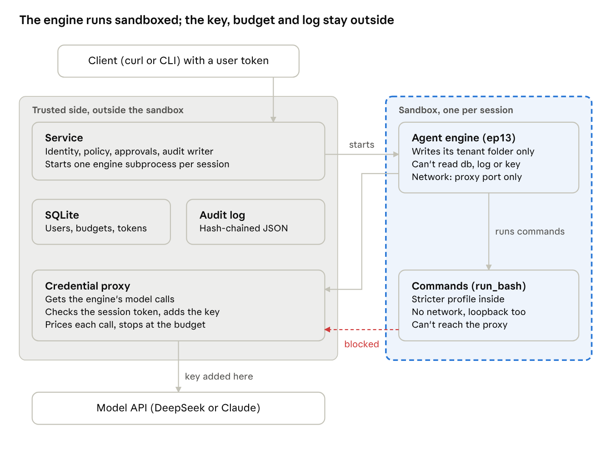

# Build an enterprise-class agent

**Series 2 of "Build your own agent": what changes when many people use one agent.**

Status: **design v1.2 (2026-11-25)**. Phase 0 is done ([`ep01/`](ep01/)) and a first end-to-end path works ([`slice/`](slice/)): token, policy, sandboxed engine, key proxy, audit chain. It is not a finished service, and no episode code is final.

[Series 1](https://github.com/HAIYANG8625Coder/build-your-own-agent) built a coding agent for **one person on one machine**: about 1,500 lines of plain Python, 13 episodes, with every test run for real. A company needs different things: many people at once, a clear answer to "who is asking", rules nobody can switch off, a record of what happened, a cost ceiling, and an agent that can run without anyone watching.

This series rebuilds the smallest honest version of each of those pieces on top of the finished series 1 agent, tests it with real runs, and compares it with what the official Claude Code docs say Claude Code does.

## Design documents (v1.2)

| Document | What it holds |
| --- | --- |
| [PRD](docs/PRD.md) | The product: problem, users, the 8 requirements with acceptance tests, product screens, success metrics, release plan |
| [TRD](docs/TRD.md) | The build: processes and ports, the request flow, API, SQLite schema, audit format, security design, policy engine, budgets, reliability, tests |
| [Prototype](prototype/) | Five clickable screens: developer session, phone approvals, admin dashboard, admin console, audit log. **[Try it live](https://haiyang8625coder.github.io/build-an-enterprise-class-agent/prototype/)** |

## How it will work

- **Same method as series 1.** Plain Python, no framework. Keys only in environment variables. One folder and one commit per episode. Every run on screen is real, including the ones that show nothing.
- **Claude Code facts come from its official documentation**, never from its source code. Where the docs are silent, the article says "our version does it this way".
- **Teaching versions, not products.** We build small versions of managed settings, sandboxing, audit logs and so on, and say where they stop. This is not legal advice, a compliance certification, or something to sell as is.

## The plan (5 parts, 13 episodes)

### A · Who and what is allowed
1. **Many users, one agent service.** Know who is asking: a user id on every request, a working folder and a session store for each user.
2. **Policy nobody can switch off.** Central settings that load before user and project settings; rules checked deny, then ask, then allow; enforced by the program, not by the prompt.
3. **Rules the model cannot argue with.** Test the policy against an agent that is told to break it (prompt injection in a file or a tool description, a command that reaches outside its folder).

### B · Isolation
4. **A sandbox for commands.** Limit what a command can touch, not only whether it runs: writes only in the working folder, network only to an allow-list.
5. **Secrets the agent never sees.** Keep keys outside the boundary, with a small proxy that adds them on the way out.
6. **Many tenants in one process.** One customer cannot read another's memory or files, and a test that tries to cross.

### C · See it and pay for it
7. **An audit log.** Answer "who did what, and was it allowed" afterwards: one structured event per prompt, tool call and permission decision, with content off by default.
8. **Cost control.** A ceiling per user and per day, with a clear stop, and a measurement of how far a run overshoots it.
9. **Evals as a gate.** The series 1 test harness runs on every change, and nothing ships when it fails.

### D · Reliability
10. **When things fail.** Timeouts, retries with back-off, and a saved session so a run resumes after a crash.
11. **A person in the loop, without a terminal.** Approvals sent to a chat or a web page, with a timeout that denies.

### E · Ship it
12. **Deploy it.** One container, one egress proxy, a pinned model version, an optional gateway.
13. **Data and the checklist.** What is stored, for how long, and who can read it; a one-page checklist; what Claude Code has that ours does not.

The plan is based on the enterprise pages of the Claude Code documentation (settings and managed settings, permissions, monitoring, costs, data usage, sandboxing, hosting and secure deployment, LLM gateways). The pages not yet read (admin setup, server-managed settings, network configuration, zero data retention, HIPAA setup, and the Claude apps gateway pages) are read before the episodes that depend on them.

## What this is not promised to be

- Compliance certification, legal advice, or a finished product.
- Anything the docs did not say.
- The exact list of episodes. It may change after the first real tests (series 1 changed twice).

## Follow along

Star or watch this repo for updates. Tell us what you want first by opening an issue.

## License

MIT, see [LICENSE](LICENSE).
