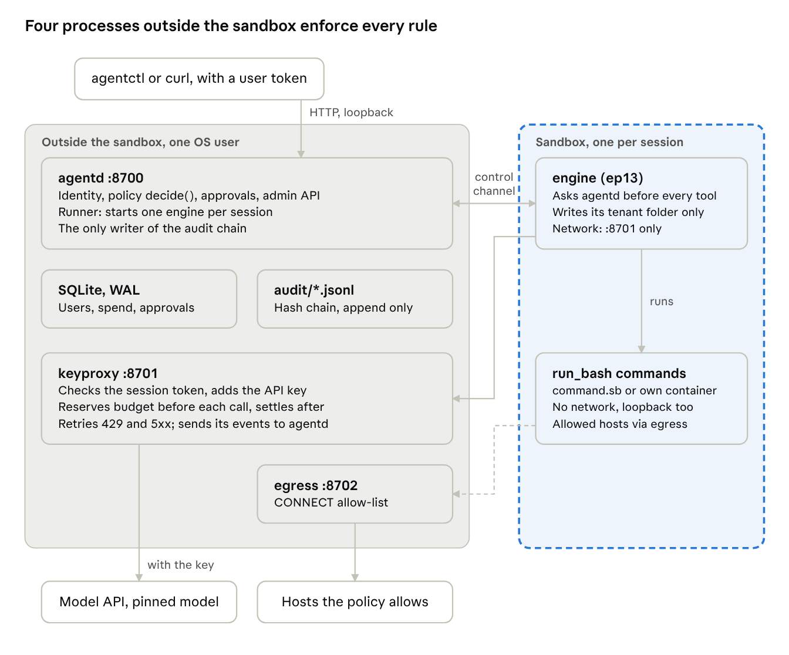
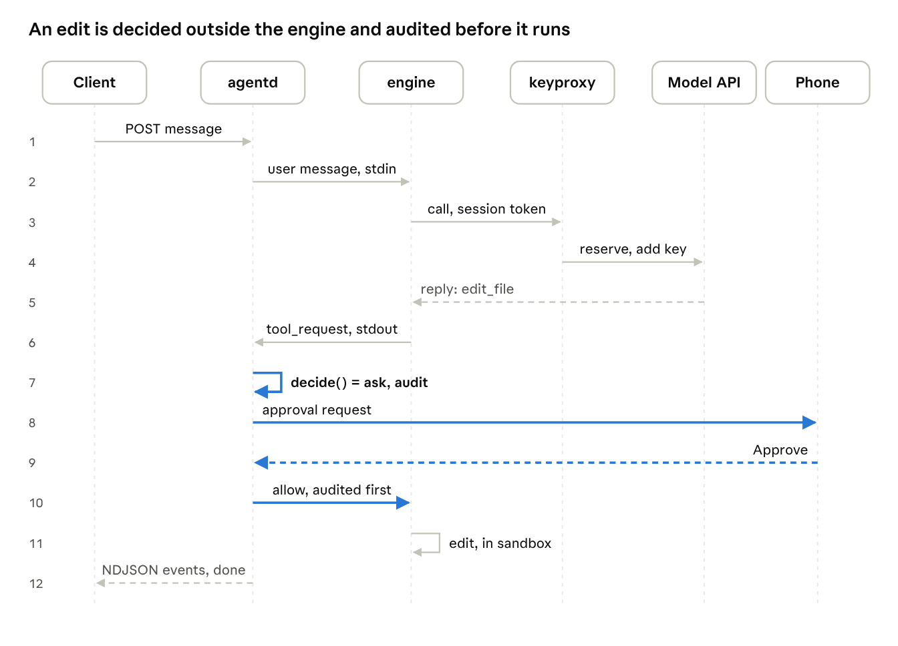

# TRD: agentd, the Enterprise-class Agent Service

Version 1.1 (draft) · v1.0 approved 2026-11-22 · v1.1 changes approved by Michael 2026-11-24

This TRD turns the approved PRD and prototype into a build specification. It fixes the processes, interfaces, data formats and tests. Values marked *proposed* are starting values that Phase 0 may tune.

| Field | Value |
| --- | --- |
| Version | 1.0, approved 2026-11-22 |
| Based on | the [PRD](PRD.md) and the [prototype](../prototype/), both approved 2026-11-22 |
| Code | `build-an-enterprise-class-agent` (public), engine from `agent-from-scratch/ep13` |
| Runtime | Python 3.9, standard library for new code. The engine keeps its `anthropic` SDK |
| Platforms | macOS with `sandbox-exec`, and Linux in Docker (Colima on the Mac, GitHub Actions in CI) |
| Out of scope | Web UI build, SSO, clusters and high availability, compliance certification (PRD non-goals) |

## 1. Scope: requirements to components

Every PRD requirement is met by a component outside the sandbox. The engine is never the only thing that enforces a rule.

| Req | Requirement | Enforced by | Checked by |
| --- | --- | --- | --- |
| R1 | Identity | Service: bearer token lookup, roles | `test_identity.py` |
| R2 | Policy | Service policy engine; the engine asks the service before every tool call | `test_policy.py`, red-team set |
| R3 | Isolation | Sandbox profile around the engine, stricter profile for commands, per-tenant folders | `test_sandbox.py`, `test_tenancy.py` |
| R4 | Secrets | Credential proxy holds the key; engine gets a session token | `test_secrets.py` |
| R5 | Audit | Audit writer in the service and the proxy, hash chain | `test_audit.py`, `verify_audit.py` |
| R6 | Cost | Credential proxy: budget check before each model call | `test_budget.py` |
| R7 | Reliability | Runner (timeouts, resume), proxy (retries), approval queue (timeout) | `test_resume.py`, `test_approvals.py` |
| R8 | Release gate | `check.sh` and GitHub Actions | CI on every push |

## 2. Architecture

Four processes run outside the sandbox and hold everything that enforces a rule: the database, the audit log, the API key and the budget. Each session's engine runs inside a sandbox and can reach only `keyproxy`.



The engine talks to `agentd` only over its stdin and stdout (the control channel), and to `keyproxy` only with its session token. Commands run one level deeper with no network, except through `egress` to hosts the policy allows (dashed).

## 3. Components

The system is four long-running processes plus one engine process per session. They talk over loopback HTTP and over the engine's stdin and stdout.

| Component | Process | Responsibility | Interface | Files |
| --- | --- | --- | --- | --- |
| Service | `agentd` (1, outside sandbox) | Identity, policy decisions, approvals, session runner, audit writer, admin API | HTTP on 127.0.0.1:8700 | `service/server.py`, `auth.py`, `policy.py`, `approvals.py`, `runner.py`, `audit.py`, `store.py` |
| Session runner | Thread in the service | Starts one engine per session under the sandbox, relays messages, enforces turn and session timeouts | Control channel: JSON lines on the engine's stdin and stdout | `service/runner.py` |
| Engine | `engine` (1 per session, inside sandbox) | The ep13 agent loop. Asks the service before every tool call, reports tool events | Control channel; model calls to the proxy only | `engine/agent.py` (ep13), `engine/bridge.py` |
| Credential proxy | `keyproxy` (1, outside sandbox) | Checks session tokens, adds the API key, prices calls, enforces budgets, retries, writes proxy audit events | HTTP on 127.0.0.1:8701, Anthropic Messages API shape | `proxy/keyproxy.py`, `proxy/pricing.py` |
| Egress proxy | `egress` (1, outside sandbox) | HTTP CONNECT allow-list for hosts the policy allows commands to reach | HTTP CONNECT on 127.0.0.1:8702 | `proxy/egress.py` |
| Store | SQLite file, WAL mode | Users, tokens, sessions, approvals, budgets, policy versions | `store.py` only; no other component opens it | `data/agentd.db` |
| Client | `agentctl` CLI, `curl` | User and admin commands | Service HTTP API | `client/agentctl.py` |

**Control channel.** The engine and the runner exchange one JSON object per line. The engine sends `tool_request`, `tool_result`, `text`, `done` and `error`. The runner answers each `tool_request` with `{"type":"decision","id":…,"value":"allow"|"deny","reason":…}`. The engine never decides permissions itself, so a compromised engine can only skip asking. The sandbox still stops what a skipped check would have allowed.

## 4. Main request flow

The tax edit from the prototype shows the full path. A tool call goes from the engine to `agentd`, a person approves it on the phone, and the decision is audited before the engine runs it.



Steps 7 to 10 (highlighted) are the approval path. A tool call allowed by a rule skips 8 and 9. One denied by a rule skips them too, and the engine gets `deny` with the rule's name, as the blocked `curl` did.

## 5. API specification

The service speaks JSON over HTTP on loopback. Every call except `/health` needs `Authorization: Bearer <user token>`, and every call writes one audit event.

| Method and path | Role | Request | Response | Prototype screen |
| --- | --- | --- | --- | --- |
| `POST /sessions` | user | `{"project":"shop"}` | `201 {"id":"s-0142","state":"idle"}` | Developer session |
| `GET /sessions` | user | none | own sessions, newest first | Session list |
| `GET /sessions/<id>` | user | none | state, history, cost, model calls | Session details |
| `POST /sessions/<id>/messages` | user | `{"text":"..."}` | `200` stream of NDJSON events, see below | Transcript |
| `GET /approvals?state=waiting` | user | none | own waiting requests with `expires_at` | Phone, Waiting tab |
| `POST /approvals/<id>` | user | `{"decision":"allow"\|"deny"}` | `200`, or `409` if already answered or expired | Phone, Approve and Deny |
| `GET /policy` | admin | none | current version, rules, locks | Company policy |
| `PUT /policy` | admin | full policy with `base_version` | `200 {"version":8}`, `409` if `base_version` is stale | Publish v8 |
| `GET /members` | admin | none | members, roles, caps, token state | Members and budgets |
| `POST /tokens` and `DELETE /tokens/<id>` | admin | `{"user":"sam@acme","role":"user"}` | new token shown once, or `204` | Revoke and Restore |
| `PUT /budgets/<user>` | admin | `{"daily_cap_usd":5.0}` | `200` | Daily cap |
| `GET /audit?source=&since=&limit=` | admin | none | events, newest first | Audit log |
| `POST /audit/verify` | admin | none | `{"ok":false,"broken_at":1281,"checked":1284}` | Verify the chain |
| `GET /admin/summary?period=today\|7d` | admin | none | every number on the dashboard | Dashboard |
| `GET /health` | none | none | `200 {"ok":true}` | Operator |

**Message stream.** `POST /sessions/<id>/messages` returns chunked NDJSON, one event per line, in the order the transcript shows them:

```json
{"type":"tool","name":"read_file","args":"cart.py","decision":"allow","rule":"project: Read(*)"}
{"type":"tool","name":"bash","args":"curl ...","decision":"deny","rule":"company: Bash(curl *)","event":1281}
{"type":"approval","id":"a1","tool":"edit_file","diff":"...","expires_at":"2026-11-22T09:46:12Z"}
{"type":"text","text":"Done. The tax is 9% ..."}
{"type":"done","cost_usd":0.07,"model_calls":6}
```

**Errors.** Each error body is `{"error":"<code>","message":"<what to do>"}`. The codes are `unauthorized` (401), `forbidden` (403, wrong role), `not_found` (404), `conflict` (409), `budget_exceeded` (429, with the cap and the amount spent), `session_busy` (409, one message at a time per session) and `internal` (500).

## 6. Data model

State lives in one SQLite file that only the service and the proxy open. The audit log is a separate append-only file, so a database restore can't rewrite history.

**SQLite schema** (`data/agentd.db`, WAL mode, `busy_timeout` 5000 ms, one connection per thread)

```sql
CREATE TABLE users (
  id TEXT PRIMARY KEY,            -- 'lin@acme'
  tenant TEXT NOT NULL,           -- 'acme'
  role TEXT NOT NULL CHECK (role IN ('user','admin')),
  token_hash TEXT NOT NULL UNIQUE,-- sha256 of the bearer token
  created_at TEXT NOT NULL,
  revoked_at TEXT
);
CREATE TABLE sessions (
  id TEXT PRIMARY KEY,            -- 's-0142'
  user_id TEXT NOT NULL REFERENCES users(id),
  tenant TEXT NOT NULL,
  project TEXT NOT NULL,
  state TEXT NOT NULL,            -- idle | running | waiting | stopped | failed
  saved_path TEXT NOT NULL,       -- engine's saved conversation
  created_at TEXT NOT NULL,
  last_active_at TEXT NOT NULL
);
CREATE TABLE session_tokens (
  token_hash TEXT PRIMARY KEY,
  session_id TEXT NOT NULL REFERENCES sessions(id),
  expires_at TEXT NOT NULL
);
CREATE TABLE approvals (
  id TEXT PRIMARY KEY,
  session_id TEXT NOT NULL REFERENCES sessions(id),
  tool TEXT NOT NULL,
  summary TEXT NOT NULL,          -- diff or command shown to the person
  rule TEXT NOT NULL,
  state TEXT NOT NULL,            -- waiting | allowed | denied | expired
  created_at TEXT NOT NULL,
  expires_at TEXT NOT NULL,
  answered_by TEXT
);
CREATE TABLE budgets (
  user_id TEXT PRIMARY KEY REFERENCES users(id),
  daily_cap_usd REAL NOT NULL
);
CREATE TABLE spend (
  user_id TEXT NOT NULL, day TEXT NOT NULL,
  spent_usd REAL NOT NULL DEFAULT 0, reserved_usd REAL NOT NULL DEFAULT 0,
  input_tokens INTEGER NOT NULL DEFAULT 0, output_tokens INTEGER NOT NULL DEFAULT 0,
  model_calls INTEGER NOT NULL DEFAULT 0, retries INTEGER NOT NULL DEFAULT 0,
  PRIMARY KEY (user_id, day)
);
CREATE TABLE policy_versions (
  version INTEGER PRIMARY KEY,
  body TEXT NOT NULL,             -- the policy JSON
  published_by TEXT NOT NULL,
  published_at TEXT NOT NULL
);
```

**Audit event** (one JSON line in `audit/YYYY-MM-DD.jsonl`)

```json
{"n":1281,"time":"2026-11-22T09:41:07Z","tenant":"acme","user":"lin@acme",
 "session":"s-0142","type":"tool_decision","tool":"bash","decision":"deny",
 "rule":"company: Bash(curl *)","source":"service","content":null,
 "prev":"9f2c…","hash":"41ab…"}
```

`hash` is SHA-256 of `prev` plus the event's canonical JSON (sorted keys, no `hash` field). The first line of a day carries the last hash of the day before. `source` is `service`, `proxy` or `engine`. `content` stays `null` unless content logging is turned on.

**Files on disk**

| Path | Holds | Who can read |
| --- | --- | --- |
| `data/agentd.db` | The tables above | Service, proxy |
| `data/key` | Model API key, mode 0600 | Proxy only |
| `audit/*.jsonl` | Audit chain | Service (writes), admins through the API |
| `tenants/<tenant>/<user>/<project>/` | Project files | That tenant's engine sessions |
| `tenants/<tenant>/<user>/.agent/` | Saved sessions, memory, skills | That user's engine sessions |

## 7. Security design

We assume the engine can be turned against us by a prompt injection, so every control that matters sits outside it. Each threat below has a control and a test that tries to break it.

| Threat | Control | Test |
| --- | --- | --- |
| Prompt injection asks the agent to send a secret out | Company deny rules; commands have no network; the egress allow-list for allowed hosts | Red-team file asks for `curl` with `~/.ssh/id_rsa`; expect deny and no outbound connection |
| Engine reads the API key | Key only in `data/key`, mode 0600, outside the engine's sandbox; engine env has a session token only | Grep the engine's environment and every readable file for the key |
| Command spends the key through the local proxy | Command profile blocks all network, loopback included; proxy requires a session token | `curl 127.0.0.1:8701` from `run_bash` fails |
| Engine edits the audit log or the database | Both paths are outside the engine's readable and writable set | Engine `read_file` and `write_file` on them fail |
| Tenant A reads tenant B | Engine profile allows only its own tenant folder; paths resolved with `realpath` | Path, `..`, symlink and memory-file escapes all fail |
| Repository loosens the policy | Project and user allow rules ignored when "Company rules only" is on | A repo `settings.json` with `allow: ["Bash(*)"]` changes nothing |
| Stolen user token | Tokens hashed at rest; admin revokes; every use is audited | A revoked token gets 401 |
| Partial log tampering | Hash chain, verified on demand and daily | Edit or delete one line; `verify` names it |
| Whole-file log rewrite (v1.1) | The service writes the newest chain hash to an anchor the engine can't reach | Replace the whole file with a valid new chain; `verify` reports an anchor mismatch |
| Engine reports less than it did (v1.1) | Cross-check of engine events against proxy model calls and service decisions | Engine omits a tool event; a `mismatch` audit line appears |

**Not defended.** A full rewrite of the audit log is caught only through the anchor (v1.1, section 6); someone who owns the host can rewrite both the log and the anchor, and real systems ship logs to a separate store. Data sent to an allowed host is not inspected. Kernel or `sandbox-exec` escapes are out of scope.

**Sandbox profiles.** Two profiles, generated per session from a template. This is a sketch: the exact SBPL must be tested in Phase 0, because Apple doesn't document it.

```scheme
; engine.sb, around the whole engine process
(version 1)
(deny default)
(allow process-fork process-exec)
(allow file-read* (subpath "/usr") (subpath "/System") (subpath "/Library")
                  (subpath (param "PYTHON_HOME")) (subpath (param "TENANT_DIR")))
(allow file-write* (subpath (param "TENANT_DIR")) (subpath (param "TMP_DIR")))
(allow network-outbound (remote ip "localhost:8701"))   ; credential proxy only

; command.sb, used by run_bash inside the engine
; same as engine.sb, but with no network rule at all
```

On Linux the same split uses Docker. Engine container flags: `--cap-drop ALL --read-only --user 1000:1000 --security-opt no-new-privileges --tmpfs /tmp`, mounting only the tenant folder, on a network that reaches only `keyproxy`. Network is set per container, so each command runs in its own short-lived container (`docker run --rm --network none`, same flags, same tenant folder). The engine container therefore needs a way to start it: the runner starts command containers on the engine's behalf over the control channel, and the engine never gets the Docker socket.

**Tokens.** User tokens are 32 random bytes (`secrets.token_urlsafe`), shown once, and stored as SHA-256. Session tokens are created per session, expire with the session (8 hours at most, *proposed*), and are deleted when it stops.

**One audit writer.** The proxy doesn't write the chain file. It sends its events to the service on an internal loopback endpoint that needs a shared secret, and the service appends them, so the chain has a single writer.

## 8. Policy engine

The service decides every tool call with one function, `decide(user, project, tool, args)`, from three rule sources. The company policy can't be loosened by the other two.

**Rule syntax.** `Tool(pattern)`, extending the ep4 `Permissions` class. `Tool` is `Read`, `Edit`, `Write` or `Bash`, and the pattern is a glob on the path or on the command line. Examples from the prototype: `Bash(curl *)`, `Read(~/.ssh/**)`, `Edit(*)`.

**Sources.** Company rules come from the policy version in SQLite, project rules from `<project>/.agent/settings.json` and user rules from `tenants/<tenant>/<user>/.agent/settings.json`.

**Evaluation**

```python
def decide(rules, locks, tool, args):
    company = rules.company
    others = rules.project + rules.user
    if locks.company_rules_only:
        others = [r for r in others if r.effect != "allow"]   # their deny and ask still count
    every = company + others
    for effect in ("deny", "ask", "allow"):                   # deny, then ask, then allow
        hit = first_match(every, effect, tool, args)
        if hit:
            return effect, hit                                # the rule is logged with the decision
    return "ask", None                                        # no rule: ask a person
```

**Locks.** `company_rules_only` drops allow rules that don't come from the company. `disable_bypass` refuses any session that asks to run tools without asking. Both live in the policy body, so changing them is a new version.

**Versions.** `PUT /policy` carries `base_version`. The service rejects a stale base with 409, stores the new body as the next version, writes an audit event and applies it from each session's next tool call. A running tool call is not interrupted.

**Known limit.** Bash patterns match the command text, so `curl` inside a script file is not caught by `Bash(curl *)`. The sandbox's "no network" is what actually stops it, and the red-team set includes that case.

## 9. Cost and budget

The proxy reserves the worst-case cost of a call before sending it and settles the real cost afterwards. So a member can never pass their cap by more than the gap between a call's estimate and its real cost.

**Prices.** `config/pricing.json` maps the pinned model to USD per million input and output tokens. The values are copied from the provider's price page at setup and dated. The cost shown is an estimate, as the docs say for Claude Code too.

**Check before each call** (in `keyproxy`, inside one SQLite transaction)

```python
est_in = len(request_json) // 3                 # rough token count, errs high
est_out = request["max_tokens"]
reserve = price_in * est_in + price_out * est_out
row = spend(user, today)
if row.spent + row.reserved + reserve > cap(user):
    return 429, {"error": "budget_exceeded", "cap_usd": cap, "spent_usd": row.spent}
row.reserved += reserve                          # then forward the call
# after the response:
row.reserved -= reserve
row.spent += price_in * usage.input_tokens + price_out * usage.output_tokens
```

**Overshoot bound.** Output can't exceed `max_tokens`, so only a low input estimate can push spend over the cap. The test records the overshoot on a run built to cross the cap; the target is under one call's cost. Reserving also stops two parallel sessions of one member from both slipping under the cap.

**Day boundary.** Days are counted in the tenant's time zone (*proposed*: set in config, default UTC). Caps reset at midnight, and a running session continues under the new day's cap.

## 10. Reliability

Every wait has a limit, every limit fails closed, and a crash loses at most the tool call that was running. All values are *proposed* and live in `config/limits.json`.

| Situation | Limit | What happens |
| --- | --- | --- |
| One model call | 120 s | Proxy cancels it; counts as an error for retry |
| 429, 5xx or a dropped connection | 4 attempts | Back-off 1, 2, 4, 8 s with jitter; honours `retry-after`; each retry counted in `spend.retries` |
| One turn (a message until `done`) | 10 min | Runner stops the engine, saves the session, streams `error: turn_timeout` |
| Idle session | 30 min | Engine stopped, session saved, state `idle`; the next message starts a new engine and resumes |
| Waiting approval | 5 min | State `expired`, decision deny, audit event, the engine is told "denied: no answer" |
| Engine crash | n/a | Runner marks the session `failed`, keeps the saved file; the next message resumes from it |
| Service restart | n/a | On start, `running` and `waiting` sessions become `idle`; waiting approvals become `expired` |

**Resume.** The engine already saves the conversation after each turn (ep13 `--continue`). The runner starts it with the session's saved path. A turn cut off mid-way is repaired the same way ep13 repairs a Ctrl+C: unanswered tool calls get a "stopped" result before the next message.

**Order of writes.** The audit event for a decision is written before the decision is sent to the engine. If the service dies in between, the log shows a decision the engine never got, never the reverse.

## 11. Dashboard and metrics

`GET /admin/summary?period=today|7d` returns every number on the prototype dashboard. Each one comes from a table or the audit log, never from the engine.

| Dashboard item | Computed from |
| --- | --- |
| Spend, of daily caps | `SUM(spend.spent_usd)` for the period; `SUM(budgets.daily_cap_usd)` |
| Tokens, in and out | `SUM(spend.input_tokens)`, `SUM(spend.output_tokens)` |
| Model calls, retried after a 429 | `SUM(spend.model_calls)`, `SUM(spend.retries)` |
| Sessions, running now | `COUNT(sessions)` created in the period; `state = 'running'` |
| Approvals by outcome | `approvals.state` grouped: allowed, denied, expired, waiting |
| Blocked by policy, most blocked rules | Audit events with `decision = 'deny'` grouped by `rule` |
| Sandbox escapes | Red-team result from the last CI run (always shown with its date) |
| Tokens per day | `spend` grouped by `day`, last 7 days |
| Members table | `users` joined with `spend` and `budgets`; last active from `sessions.last_active_at` |
| Needs your attention | Members at 90% or more of the cap; waiting approvals with the earliest `expires_at`; refused-token events today |
| Safety checks | Last `POST /audit/verify` result; current policy version; pinned model from config |

Audit-derived numbers are cached for 60 s (*proposed*) so the dashboard doesn't rescan the log on every load.

## 12. Deployment and configuration

One command starts everything on the Mac, and one compose file starts it in Docker. Both read the same environment variables.

| Variable | Used by | Default (*proposed*) |
| --- | --- | --- |
| `AGENTD_HOME` | all | `./var` (holds `data/`, `audit/`, `tenants/`) |
| `AGENTD_PORT`, `KEYPROXY_PORT`, `EGRESS_PORT` | service, proxies | 8700, 8701, 8702, loopback only |
| `AGENTD_SANDBOX` | runner | `seatbelt` on macOS, `docker` on Linux |
| `MODEL_PROVIDER`, `MODEL_NAME` | proxy | `deepseek`, `deepseek-flash` (pinned, never "latest") |
| `MODEL_KEY_FILE` | proxy | `$AGENTD_HOME/data/key` |
| `INTERNAL_SECRET_FILE` | service, proxy | `$AGENTD_HOME/data/internal` (proxy-to-service audit endpoint) |
| `AUDIT_CONTENT` | service | `off` |
| `RETENTION_DAYS` | retention sweep | 30 for sessions, 365 for audit |

**On the Mac.** `./run.sh` creates `var/`, starts `keyproxy`, `egress` and `agentd`, and prints the first admin token once. Engines run under `sandbox-exec -f engine.sb`.

**In Docker.** `compose.yaml` has three services, `agentd`, `keyproxy` and `egress`, plus engine and command containers started by the runner. Engine containers join an internal network that reaches only `keyproxy`. The key is mounted only into `keyproxy` as a secret. Docker runs on the Mac through Colima, and natively in CI.

**Retention.** A daily sweep deletes saved sessions older than `RETENTION_DAYS`, redacts strings that look like keys in session files, and never touches the audit log before its own limit.

## 13. Testing and release gate

Three layers of tests guard every change: fast checks with no key, sandbox checks on both platforms, and scheduled real runs. A change merges only when the first two pass.

| Layer | What | Model | Where | When |
| --- | --- | --- | --- | --- |
| Unit and contract | API, policy decisions, budget math, audit chain, control channel | Scripted fake model, fake clock | Mac and CI | Every push |
| Sandbox | Each threat in section 7, tried for real | Fake model that requests the escape | `sandbox-exec` on the Mac; Docker on the Mac and in CI | Every push |
| Real evals | Red-team set and task set from the ep12 harness, 5 trials each | DeepSeek flash | CI with a repository secret | Nightly, and before a release tag |

**Test per requirement**

| Req | Must fail first, then pass |
| --- | --- |
| R1 | No token, a revoked token, a user token on an admin route: 401 or 403 |
| R2 | Company deny beats a user allow; a repo `settings.json` can't loosen the policy; a stale `base_version` gets 409 |
| R3 | `touch ../x`, a symlink out, `~/.ssh`, the db, another tenant's folder: all refused by the OS, not only by the engine |
| R4 | The key isn't in the engine's environment or readable files; `curl` to the proxy from a command fails; a bad session token gets 401 |
| R5 | Removing or editing any one line makes `verify` report that line number |
| R6 | A run built to cross the cap stops with `budget_exceeded`; the recorded overshoot is under one call |
| R7 | Kill the engine mid-task, resume, finish; an unanswered approval expires at 5 min on the fake clock |
| R8 | A pull request that breaks one check can't merge (branch protection on `checks.yml`) |

**Gate.** The real evals use pass^k with k = 5: a task passes only if all 5 trials pass. Every failed trial saves its trace as a CI artifact. Numbers used in videos come from those trace files by code, as in series 1.

**Workflows.** `.github/workflows/checks.yml` runs the first two layers on every push and pull request (no secrets, so forks are safe). `evals.yml` runs nightly with the model key as a repository secret, and never on pull requests from forks.

## 14. Repository layout and build order

The repo keeps one folder per episode, each a full copy that runs on its own, as in series 1. The final folder has this shape:

```text
build-an-enterprise-class-agent/
  README.md  SYLLABUS.md  THREAT-MODEL.md  LICENSE
  articles/                      one article per episode
  ep13/                          the last episode, complete
    service/   server.py auth.py policy.py approvals.py runner.py audit.py store.py summary.py
    engine/    agent.py (from series 1 ep13) bridge.py
    proxy/     keyproxy.py egress.py pricing.py
    sandbox/   engine.sb command.sb Dockerfile.engine
    client/    agentctl.py
    config/    pricing.json limits.json policy.example.json
    tests/     test_identity.py test_policy.py test_sandbox.py test_tenancy.py test_secrets.py
               test_audit.py test_budget.py test_resume.py test_approvals.py fakes.py
    evals/     redteam/ tasks/ (ep12 harness)
    compose.yaml  run.sh  check.sh  verify_audit.py
  .github/workflows/  checks.yml  evals.yml
```

**Build order.** The release plan in the PRD stands: Phase 0, then the vertical slice, then phases A to E. The slice proves the riskiest choices before any filming:

1. `store.py` and `auth.py` with a fake clock: tokens, roles, 401s.
2. `policy.py` with `decide()` and the three rule sources.
3. The control channel: `bridge.py` in the engine and `runner.py` in the service, with a fake model.
4. `engine.sb` around the engine, with `read_file` on the db failing.
5. A stub `keyproxy` that checks the session token and counts calls.
6. `audit.py` with the chain and `verify_audit.py`.
7. One real run on DeepSeek through all of it, end to end.

## 15. Open technical questions

Six questions decide details, not the architecture. Phase 0 answers the first three by experiment.

- [ ] **Seatbelt profile:** can the Python engine start and import its packages under `(deny default)` with only the paths in section 7? Default: test in Phase 0, widen only the paths that fail, and list each one.
- [ ] **Loopback rule:** does `sandbox-exec` allow one loopback port while blocking others? If not, the proxy listens on a Unix socket inside the tenant's temp folder instead.
- [ ] **DeepSeek usage fields:** does every response carry input and output token counts in the Anthropic shape? Default: check in Phase 0; if not, the proxy counts from the response text and marks spend as estimated.
- [ ] **Docker socket:** the runner needs Docker to start command containers, and that socket is powerful. Default: give it only to the service, never to engines, and say so in the threat model.
- [ ] **Streaming format:** NDJSON over chunked HTTP, or server-sent events? Default: NDJSON, since `curl` and the standard library handle it simply.
- [ ] **Proposed values:** limits in section 10, the 8-hour session token, 60 s dashboard cache, UTC days. Default: accept for Phase 0 and tune from real runs.

**Added in v1.1 (2026-11-24), all unconfirmed until tested**

- [ ] **Anchor:** where does the newest chain hash live (a file outside the sandbox, or a read-only Docker volume)? Default: a file outside `AGENTD_HOME/audit/`, written after every event.
- [ ] **Docker networking:** services bind to `127.0.0.1` on the Mac, which a container under Colima can't reach. Default: run `keyproxy` in a container on an internal network, test it in Phase 0.
- [ ] **`sandbox-exec` here:** a test run from the build session was killed (exit 137). Default: re-test from a plain terminal in Phase 0 before relying on it.
- [ ] **Colima health:** `colima status` did not return in 120 s from the build session, though `docker version` answered. Default: re-check in Phase 0.
- [ ] **Unread docs pages:** admin-setup, server-managed-settings, managed-mcp, network-config, zero-data-retention, hipaa-setup, the Claude apps gateway pages, plugins/org. Default: read them in Phase 0 and mark each claim.
